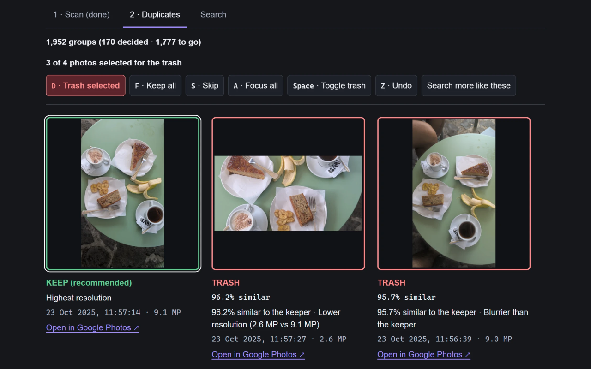
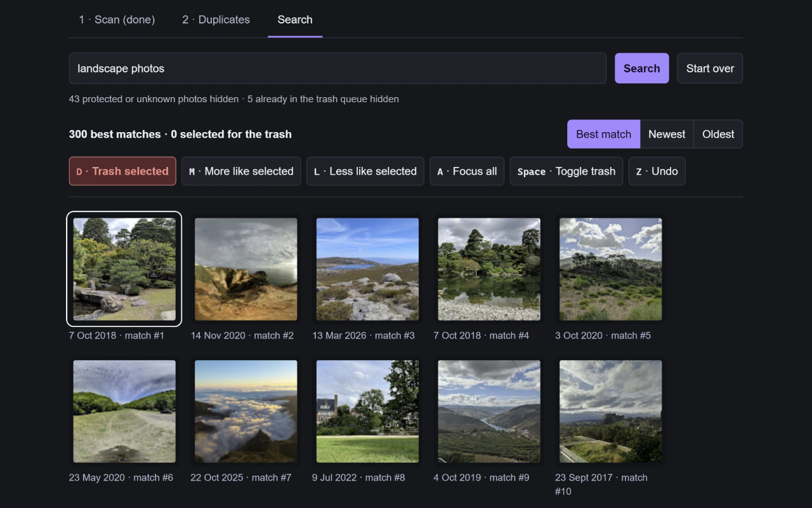

# Photo Cleaner

**Find duplicates and clutter in Google Photos with AI that runs on your computer.**

A Chrome extension for large photo libraries. Review similar shots, choose what to keep, or describe the photos you want to find. Photo Cleaner moves only the photos you approve to Google Photos' trash, and Undo restores them.

[Privacy policy](https://gaborbiro.github.io/google-photo-cleaner/privacy.html) · [Project roadmap](docs/roadmap.md) · [Report an issue](https://github.com/gaborbiro/google-photo-cleaner/issues)

[](https://github.com/gaborbiro/google-photo-cleaner/actions/workflows/build-and-release.yml)

## See it in action

### Review duplicates

Compare similar photos side by side, see why a keeper is recommended, and work through groups with keyboard shortcuts.



### Search in your own words

Search for descriptions such as "landscape photos", then refine the results with **More like selected** and **Less like selected**.



## What it does

- **Find near-duplicates:** group bursts, retakes and similar shots, with recommendations based on resolution and quality.
- **Search and sweep:** find unwanted photos by description, refine the matches and review a selection before trashing it.
- **Protect important photos:** favourites, photos in albums and archived photos are protected by default; each protection can be changed. Photos whose status is uncertain are never offered.
- **Keep scans running in the background:** the toolbar popup, Google Photos panel and review tab share saved progress.
- **Keep analysis local:** AI runs on the graphics card through WebGPU, with library data stored in the browser.

## Engineering highlights

- **Kotlin Multiplatform rules:** protection, duplicate grouping, keeper choice and the review queue are tested in Kotlin and compiled to JavaScript for the extension.
- **TypeScript and React:** separate models provide the screens' text, counts and states; the UI presents those results.
- **Persistent background work:** an offscreen extension document handles scanning and AI analysis, with IndexedDB retaining state when the UI closes.
- **Checks before every write:** current protection choices and a fresh scan are checked again before photos are trashed. Trash and restore operations are isolated in the Google Photos page script.
- **Automated checks:** CI builds the shared Kotlin rules, runs their tests, then checks types, runs extension tests and builds the extension.

## Project status and requirements

Actively developed; see the [roadmap](docs/roadmap.md) for progress and planned work. The current product is the browser extension; the earlier desktop prototype remains in Git history.

Running it requires a desktop Chrome browser with WebGPU support and a signed-in Google Photos tab. The AI model is downloaded on first use; a large library's initial analysis can take time, and review can start while analysis continues.

## Build and test

Use **JDK 22** and **Node 24**. The [agent and contributor guide](AGENTS.md) covers the environment and project conventions.

```sh
cd extension
npm ci
npm run check
```

`npm run check` builds the shared Kotlin rules, runs their tests, then runs the extension's typecheck, tests and build. It is also the command used in CI.

Once the [one-time GitHub settings](docs/github-releases.md) are added, each successful master push
automatically publishes a versioned extension ZIP in [GitHub Releases](https://github.com/gaborbiro/google-photo-cleaner/releases).
Builds, tests, version numbering and packaging run on GitHub; Chrome Web Store submission stays manual.

## Run the browser extension

1. From `extension/`, run `npm run kotlin && npm run build`.
2. Open `chrome://extensions`, enable **Developer mode**, choose **Load unpacked**, and select `extension/dist-app`.
3. Open photos.google.com, signed in, and start a scan from the panel or the toolbar popup.

Before a release, or after changing browser integrations, go through the [manual Chrome checks](docs/extension-manual-checks.md).

## Explore the code

| Area | Where to start |
|---|---|
| Browser extension, screens and background engine | [extension/src/app/](extension/src/app/) |
| Google Photos page operations and relay | [extension/src/page/](extension/src/page/), [extension/src/content/relay.ts](extension/src/content/relay.ts) |
| Shared protection and duplicate rules | [features/shared/protection/](features/shared/protection/), [features/shared/duplicates/](features/shared/duplicates/) |
| Domain models | [repositories/](repositories/) |
| Extension tests | [extension/test/](extension/test/) |
| Decisions, findings and roadmap | [docs/](docs/) |

## Security and privacy

- AI analysis runs locally; photo previews are not sent to an AI service.
- Google session tokens stay inside the photos.google.com page; the extension never sees cookies or tokens.
- Only numbers about photos are stored, such as fingerprints, quality and dates, never images, and only in the browser. **Erase Photo Cleaner's data** removes what it stored.
- Logs never contain tokens, photo keys, album titles or URLs.
- Optional usage statistics go directly to Google Analytics only after you agree. They describe
  feature progress and fixed error categories, never photos, searches, albums or your Google account.
  Reporting can be turned off in the popup, panel or review Scan page. Developer builds send nothing;
  release configuration and reporting checks are in [usage events setup](docs/usage-events-setup.md).

Read the [privacy policy](https://gaborbiro.github.io/google-photo-cleaner/privacy.html) for details. Contributors and coding agents should read [AGENTS.md](AGENTS.md) before making changes.

